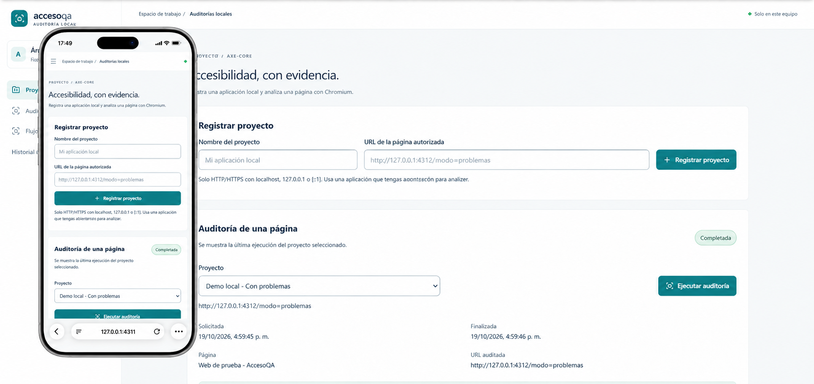

# AccesoQA — MVP local



Audita páginas y flujos de una aplicación local con **Chromium, Playwright, axe-core y SQLite**. Incluye proyectos, pasos declarativos, puntos de control, historial, comparación conservadora e informes JSON/HTML. Los hallazgos proceden de análisis reales. No calcula puntuaciones ni declara cumplimiento WCAG.

## Requisitos

- Windows, Node.js **24.x** y npm. Comprueba `node --version` y `npm --version`.
- Espacio para dependencias y Chromium; permisos de escritura en esta carpeta y la caché de Playwright.
- Internet para instalar dependencias y Chromium. La ejecución posterior es local.
- Una aplicación autorizada iniciada en `localhost`, `127.0.0.1` o `[::1]`, con sus recursos también locales.
- Mantén **una sola instancia** de la API sobre la misma base. Este MVP no es multiusuario ni está preparado para exponerse a la red.

## Instalación reproducible

Para descargar el proyecto por primera vez, abre PowerShell y ejecuta (necesitas Git instalado):

```powershell
git clone https://github.com/Angel-ETECH/AccesoQA.git
cd AccesoQA
node --version
npm --version
npm ci
npx playwright install chromium
npm run db:init
npm run dev
```

Si ya tienes el proyecto descargado, abre la terminal dentro de su carpeta y omite `git clone` y `cd`.

`npm ci` usa `package-lock.json`. Usa `npm install` si has cambiado deliberadamente dependencias y necesitas actualizar el lockfile.

| Componente | Dirección | Señal de funcionamiento |
| --- | --- | --- |
| Panel | http://127.0.0.1:4311 | Formulario para registrar proyectos |
| API | http://127.0.0.1:4310/api/health | JSON con status: ok |
| Web de demostración | http://127.0.0.1:4312 | Página de práctica |

Mantén la terminal abierta. Para detener los componentes pulsa **Ctrl+C**. Si se interrumpe una auditoría, la siguiente apertura de la API la marca como fallida; no la transforma en una página sin problemas.

### Si el Node global es 22

Puedes ejecutar temporalmente los comandos con Node 24, sin cambiar la instalación global:

```powershell
npm exec --yes --package=node@24 -- npm ci
npm exec --yes --package=node@24 -- npx playwright install chromium
npm exec --yes --package=node@24 -- npm run db:init
npm exec --yes --package=node@24 -- npm run dev
```

La primera ejecución puede descargar Node 24. Los comandos de abajo también pueden envolverse con `npm exec --yes --package=node@24 --`.

## Demostración en cinco minutos

1. Registra **Demo con problemas** con `http://127.0.0.1:4312/?modo=problemas`.
2. Pulsa **Ejecutar auditoría**. Revisa las reglas `image-alt`, `label` y `color-contrast`, el filtro por impacto y el HTML afectado.
3. Registra **Demo corregida** con `http://127.0.0.1:4312/?modo=corregido`. Ejecuta: la variante controlada no debería reproducir esos defectos. El resultado real depende de completar el análisis.
4. En el proyecto corregido, pulsa **Nuevo flujo → Cargar ejemplo de registro**, confirma el uso de datos ficticios, guarda y ejecuta. Se completan cinco pasos y dos puntos de control sin crear cuentas reales.
5. Ejecuta el mismo flujo otra vez. En **Historial y comparación**, elige una base y una revisión posterior del mismo flujo; abre una ejecución y descarga su JSON o HTML.

Para demostrar categorías nuevas/corregidas hay que cambiar el contenido servido manteniendo la misma URL y secuencia; cambiar `?modo=problemas` por `?modo=corregido` produce pantallas distintas y no es una comparación equivalente. Las pruebas automatizadas incluyen revisiones reales en una URL constante.

## Ejecutar la compilación local

```powershell
npm run build
npm start
```

Detén primero `npm run dev`, porque se utilizan los mismos puertos. `npm start` ejecuta la API compilada y sirve los `dist` de web/fixture con Vite preview. Es un modo de demostración local, no un despliegue público. Mantén la carpeta completa del proyecto y sus dependencias: el paquete compartido se resuelve desde este workspace.

## Uso y documentación

- [Crear proyectos](docs/guia-proyectos.md).
- [Ejecutar auditorías, consultar historial y exportar](docs/guia-auditorias.md).
- [Definir y ejecutar flujos](docs/guia-flujos.md).
- [Arquitectura, persistencia y límites de seguridad](docs/architecture.md).
- [Limitaciones conocidas](docs/limitaciones.md).
- [Informe de revisión final](docs/revision-final-mvp.md).
- [Defectos intencionales de la demostración](apps/fixture/DEFECTOS.md).

## Verificaciones

```powershell
npm run lint
npm run typecheck
npm run test:unit
npm run test:integration
npm test
npm run build
npm run test:production
```

`npm test` reúne la suite completa. `test:unit` ejecuta migraciones y pruebas aisladas del lanzamiento y del cliente HTTP; `test:integration` cubre API, persistencia, comparación, navegación real, limpieza e interfaz (incluye también algunas aserciones puras del comparador). Las pruebas usan servidores y bases temporales; no sustituyen los proyectos de uso.

`test:production` requiere haber compilado: inicia una API desde `dist`, sirve las dos webs compiladas, audita la demo con problemas y corregida, completa el registro, verifica JSON, axe sobre el panel y ancho de pantalla. Guarda evidencia en `data/reports/mvp-production-verification.json` y capturas en `data/screenshots/mvp-production-*.png`. No constituye una certificación de accesibilidad.

## Datos, copias y configuración

SQLite vive en `data/accesoqA.sqlite`; se crea automáticamente con migraciones transaccionales. No elimines la base para actualizar la aplicación. Conserva también sus archivos `-wal`/`-shm` si copias una base abierta; la opción sencilla es detener la API y copiar `data/` a otra carpeta. Nunca sobrescribas una base activa. Para restaurar, detén la aplicación y devuelve la copia antes de iniciar.

Variables de entorno opcionales en PowerShell (no se carga `.env` automáticamente):

```powershell
$env:ACCESOQA_DB_PATH = 'C:\ruta\datos\accesoqa.sqlite'
$env:API_PORT = '4310'
$env:FRONTEND_ORIGIN = 'http://127.0.0.1:4311'
```

Los valores predeterminados permiten iniciar sin configurar nada. Cambiar API_PORT exige ajustar el proxy del panel en `apps/web/vite.config.ts`; FRONTEND_ORIGIN debe coincidir con la dirección real del panel. El puerto de la demo debe coincidir con las URLs de los proyectos.

## Solución de problemas

| Mensaje o síntoma | Acción |
| --- | --- |
| Chromium no está instalado | Ejecuta `npx playwright install chromium` con el mismo usuario que inicia la API. |
| Chromium no inicia o se cierra | Cierra procesos innecesarios, comprueba recursos disponibles y vuelve a instalar Chromium si falta. La ejecución debe quedar fallida. |
| Página inaccesible / timeout | Abre su URL en el navegador y comprueba servidor, puerto, ruta y recursos. Una ejecución fallida no acredita ausencia de incidencias. |
| Destino bloqueado | Usa un host loopback explícito y recursos locales. No se permiten redirecciones ni dependencias remotas. |
| Puerto ocupado | Detén la instancia anterior; no inicies dos APIs sobre la misma base. |
| API no disponible | Revisa la terminal, `/api/health`, Node 24 y el proxy. El panel muestra el error y permite reintentar. |
| SQLite no abre o no puede escribir | Comprueba ruta, permisos y espacio libre; conserva una copia antes de intervenir. No hay reparación automática de corrupción. |
| Comparación no disponible | Comprueba mismo flujo, orden, URL/secuencia equivalentes, estado completo, motor/configuración e incomplete=0. La UI explica exclusiones. |

## Organización y alcance

```text
apps/api/src/audit/   motor Playwright, proxy, flujos y comparación
apps/api/src/db/      SQLite, repositorio y migraciones
apps/web/src/         panel React, flujos e historial
apps/fixture/         demo con defectos controlados
packages/shared/     contratos Zod y tipos
scripts/             verificación de la compilación
docs/                guías, arquitectura e informes
data/                datos locales, informes y capturas ignorados por Git
```

Solo se permiten URLs HTTP/HTTPS locales explícitas, sin credenciales. El proxy y el contexto validan solicitudes/redirecciones; una salida bloqueada hace fallar el análisis. Los flujos aceptan únicamente navegar, clic, completar y verificar visibilidad, con localizadores accesibles o data-testid y valores ficticios predefinidos. No admiten JavaScript ni comandos aportados por el usuario.

No incluye pagos, suscripciones, cuentas empresariales, servicios cloud ni IA externa. Consulta las limitaciones antes de usarlo con aplicaciones que contengan datos sensibles o acciones con efectos reales.
